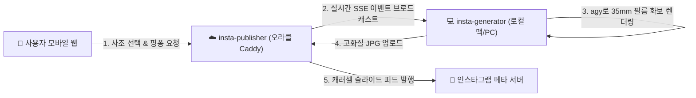

# Insta-Publisher 📸 ☁️

**오라클 클라우드 및 프로덕션 환경에서 구동되는 초경량 모바일 특화 인스타그램 화보 스튜디오 & 캐러셀 퍼블리셔**

모바일 웹 브라우저에서 20세기 패션 사조를 선택하고, 로컬 agy 렌더러와 실시간 SSE로 핑퐁 보완을 거친 뒤, 선택한 구도 순서대로 인스타그램 공식 캐러셀(슬라이드) 피드를 발행합니다.

---

## 🌟 주요 기능 및 특징

1. **📱 모바일 최적화 4단계 화보 파이프라인**
   - **Step 1 (사조 선택)**: 1900년대 깁슨 걸부터 1920s 코코샤넬, 1950s 디올 뉴룩, 1970s 펑크, 1990s 그런지까지 **총 38개 시대별 패션 사조 및 서브컬처 아카이브** 제공
   - **Step 2 (핑퐁 보완)**: 35mm 빈티지 필름 룩의 기준 컷 확인 및 빠른 피드백 프리셋(플래시 광, 필름 그레인, 캔디드 포즈 등)을 통한 점진적 재생성 루프
   - **Step 3 (구도 확장)**: 10종 전문 패션 구도 프리셋(전신 런웨이, 원단 디테일 클로즈업, 무빙 블러, 로우앵글 등) 및 커스텀 구도 추가 기능
   - **Step 4 (캡션 & 발행)**: 영문 에디토리얼 무드 본문 및 소문자 해시태그 규칙 자동 적용 후 인스타그램 공식 API로 즉시 발행

2. **🎞️ 인스타그램 공식 캐러셀(Carousel) 순서 발행**
   - 3단계에서 사용자가 터치하여 지정한 순서(`✓ #1번째`, `✓ #2번째` ...) 그대로 메타 Graph API 멀티 컨테이너 규격에 맞춰 슬라이드 포스팅 발행

3. **🔐 엔터프라이즈급 3중 보안 & 구글 OTP(MFA)**
   - **구글 OTP (RFC 6238 TOTP)**: Google Authenticator를 통한 2단계 인증 지원 (외부 라이브러리 없이 순수 Go 표준 라이브러리 구현)
   - **브루트포스 차단**: 5회 이상 로그인 실패 시 IP 기준 15분 접속 차단 및 실패 시마다 1초~5초 점진적 지연(Rate Limiting)
   - **타이밍 공격 방지**: 상수 시간 비교(`subtle.ConstantTimeCompare`) 적용

4. **⚡ 제로 디스크(Zero-Disk) 아키텍처**
   - 인스타그램 피드 업로드 완료 즉시 임시 미디어 파일 자동 영구 삭제 (오라클 프리티어 디스크 0% 유지)

---

## 🏗️ 시스템 아키텍처



---

## 🛠️ 설정 가이드 (.env)

프로젝트 루트의 `.env` 파일에 아래 환경변수를 설정합니다:

```env
# 인스타그램 Graph API 설정
INSTAGRAM_ACCOUNT_ID=122220092894485375
INSTAGRAM_ACCESS_TOKEN=EAAG...   # 메타 비즈니스 영구 토큰(Never-expire) 권장

# 관리자 계정 & 구글 OTP MFA (선택)
ADMIN_USER=admin
ADMIN_PASS=your_strong_password
MFA_SECRET=JBSWY3DPEHPK3PXP      # Base32 시크릿 (비워둘 경우 ID/PW만으로 로그인)

# 맥미니/로컬 agy 생성기 통신 인증 토큰
UPLOAD_API_TOKEN=your_secure_agent_token_here

# 공인 서비스 도메인 (인스타그램이 사진을 가져갈 수 있는 HTTPS 주소)
PUBLIC_BASE_URL=https://insta.kimpscan.com
PORT=8080
```

---

## 🚀 빠른 시작

### 1. 로컬 빌드 및 실행
```bash
go build -ldflags="-s -w" -o insta-server ./cmd/server
./insta-server
```

### 2. Docker / Caddy 배포
`oci-webserver`의 서브모듈로 통합되어 있으며, Caddyfile에 아래와 같이 등록됩니다:
```caddy
# sites/insta.kimpscan.com.caddy
insta.kimpscan.com {
    import security_headers
    encode zstd gzip
    reverse_proxy insta-publisher-app:8080
}
```

---

## 📱 Google Authenticator 등록 방법
1. `.env`에 `MFA_SECRET=JBSWY3DPEHPK3PXP` 입력
2. 스마트폰 구글 OTP 앱 실행 ➡️ `+` 버튼 ➡️ **[설정 키 입력]**
   - 계정 이름: `InstaStudio (admin)`
   - 내 키: `JBSWY3DPEHPK3PXP`
   - 유형: 시간 기반(기본값)
3. 웹 로그인 창에서 ID/PW 통과 후 표시되는 6자리 OTP 코드를 입력하면 로그인 완료!
